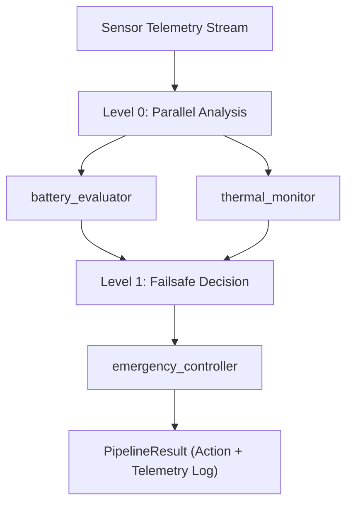

# agentflow

[](https://pypi.org/project/agentflowkit/)
[](https://github.com/KaramQ6/agentflow/actions/workflows/ci.yml)
[](https://codecov.io/gh/KaramQ6/agentflow)
[](https://pypi.org/project/agentflowkit/)
[](https://www.python.org/downloads/)
[](https://opensource.org/licenses/MIT)

**The typed multi-agent pipeline framework for Systems, IoT, and Edge Engineers.**
Define agents with decorators, wire them into a parallel DAG like a Makefile, enforce hard USD budget caps, and trigger autonomous agent workflows from live MQTT sensor streams — with only two runtime dependencies (`openai` + `pydantic`).

- **Hardware & IoT Native**: `MQTTDaemon` and `Pipeline.serve()` ingest live sensor streams (Mosquitto, HiveMQ) and trigger agent DAGs via non-blocking Pydantic threshold policies
- **Hard USD Cost Budgets**: `budget_usd=` aborts a run at a hard ceiling and hands back partial results already paid for (`BudgetExceededError.partial_result`)
- **100% Local & Free with Ollama**: drop-in support for any OpenAI-compatible server (Ollama, vLLM, LM Studio) for fully offline, private edge execution at $0.00 cost
- **Tool / function calling**: `@tool` turns any Python function (serial reads, GPIO, HTTP, subprocesses) into an LLM tool with a bounded ReAct loop
- **Parallel execution**: agents with no inter-dependencies run concurrently; a failing level cancels its siblings instead of burning tokens
- **Cost tracking**: per-agent and per-pipeline USD cost, and the run tells you which models it could not price
- **Cost budgets**: `budget_usd=` aborts a run at a hard ceiling and hands back the results you already paid for
- **Typed output that repairs itself**: declare a Pydantic schema; agentflow prompts with it, validates, and asks the model to fix a bad reply
- **Token streaming**: `LLM.astream()` yields tokens for interactive UIs
- **Decorator-based**: define agents as plain async functions, no boilerplate
- **LLM response caching**: in-memory (or Redis) cache cuts cost on repeated runs
- **Per-agent timeouts & retries**: `timeout=` and pipeline-level retry with exponential backoff + jitter
- **Conditional branching**: skip agents dynamically based on upstream outputs
- **Explainable DAG**: `pipe.explain()` prints the resolved levels without calling an LLM
- **Observability**: lifecycle `Hooks`, an OpenTelemetry adapter, and structured JSON logs with run IDs
- **Provider agnostic**: any OpenAI-compatible API (OpenAI, Groq, Together, Ollama, vLLM, OpenRouter)
- **Fully typed**: ships `py.typed`; passes `mypy --strict`
- **Minimal deps**: only `openai` + `pydantic`

📖 **[Documentation →](docs/index.md)** · [Public API & stability contract](PUBLIC_API.md) · [Design decisions](docs/adr/)

## Install

```bash
pip install agentflowkit

# Optional: MQTT daemon triggers (for IoT / robotics streams)
pip install "agentflowkit[mqtt]"

# Optional: Redis cache backend
pip install "agentflowkit[redis]"
```

## The Showcase: Drone Safety Telemetry Monitor

One run of [`examples/drone_telemetry_agent.py`](examples/drone_telemetry_agent.py): a
reactive drone safety monitor triggered over MQTT. Incoming sensor telemetry is
strictly validated with a **Pydantic schema**. If safety thresholds breach
(`battery < 15%` or descent rate `> 5 m/s`), an **autonomous agent pipeline** fires:
a flight safety assessor evaluates threat severity, an emergency responder computes
the recovery protocol (e.g. Return-To-Home or controlled landing), and the entire
run executes under a **hard USD budget ceiling**.

Works against any OpenAI-compatible API — 100% local and free with Ollama, or cloud with Groq/OpenAI.

```python
from pydantic import BaseModel, Field
from agentflow import LLM, Pipeline
from agentflow.triggers import MQTTDaemon, PydanticTriggerPolicy

class DroneTelemetry(BaseModel):
    battery: float = Field(..., ge=0, le=100, description="Battery percentage")
    altitude: float = Field(..., ge=0, description="Altitude in meters")
    altitude_drop_rate: float = Field(..., ge=0, description="Descent rate in m/s")
    gps_lat: float = Field(..., ge=-90, le=90)
    gps_lon: float = Field(..., ge=-180, le=180)

# Fire agent pipeline only when critical safety bounds fail:
policy = PydanticTriggerPolicy(
    model=DroneTelemetry,
    condition=lambda d: d.battery < 15 or d.altitude_drop_rate > 5,
    prompt_template="ALERT: Battery {battery}% | Descent {altitude_drop_rate}m/s at ({gps_lat}, {gps_lon})"
)

pipe = Pipeline(llm=llm, budget_usd=0.01)       # hard cost ceiling per telemetry event
pipe.add(threat_assessor, timeout=30)           # Level 0: classifies severity (CRITICAL / WARNING)
pipe.add(emergency_responder, depends_on=["threat_assessor"], timeout=30) # Level 1: failsafe protocol
```

Representative output (`python examples/drone_telemetry_agent.py` on telemetry anomaly):

```text
━━━ Telemetry Breach Event: Battery 12%, Altitude 80m, Descent 2.0 m/s ━━━
  ▶ threat_assessor      (level 0)
  ✓ threat_assessor      SEVERITY: CRITICAL | Imminent battery exhaustion at altitude [412 tok]
  ▶ emergency_responder  (level 1)
  ✓ emergency_responder  ACTION: RTH | Initiate immediate return-to-home to safe zone [380 tok]

  wall time: 0.84s (DAG scheduling: <2ms)
  total cost: $0.000410  (or $0.000000 on local Ollama)
```

## Architecture: Like a Makefile for Agents

agentflow compiles your declared dependencies into execution levels. Independent agents execute **concurrently** via `asyncio.gather()`, while downstream agents wait for prerequisites:



## Quick Start: Sensor Anomaly Triage in 15 Lines

You don't need an MQTT broker or hardware setup to test agentflow. Run a local sensor triage pipeline directly on simulated data:

```python
import asyncio
from agentflow import Agent, Pipeline, LLM

# Run local & free with Ollama, or use Groq / OpenAI:
llm = LLM(
    model="llama3.2",
    base_url="http://localhost:11434/v1",
    api_key="ollama",  # or your Groq / OpenAI API key
)

@Agent(name="sensor_monitor", role="Telemetry Monitor")
async def monitor(task: str, context: dict) -> str:
    return f"Evaluate this sensor payload and flag anomalies: {task}"

@Agent(name="failsafe_controller", role="Failsafe Controller")
async def failsafe(task: str, context: dict) -> str:
    analysis = context["sensor_monitor"]
    return f"Based on telemetry analysis: '{analysis}', specify safety action or NOMINAL."

# Build DAG: failsafe runs after monitor completes
pipe = Pipeline(llm=llm, budget_usd=0.01)
pipe.add(monitor)
pipe.add(failsafe, depends_on=["monitor"])

async def main():
    sensor_payload = '{"device": "jetson-edge-01", "temp_c": 92.4, "cpu_load": 98.2}'
    result = await pipe.run(sensor_payload)
    print(result.output)
    print(f"Latency: {result.wall_time:.2f}s | Cost: ${result.total_cost:.6f}")

asyncio.run(main())
```

## Run 100% Local with Ollama (Offline & Free)

For edge devices (Raspberry Pi 5, Jetson Orin) or air-gapped systems where cloud APIs are unacceptable:

```bash
# 1. Start Ollama with any model:
ollama run llama3.2
```

```python
from agentflow import LLM

# Point agentflow to your local Ollama instance:
llm = LLM(
    model="llama3.2",
    base_url="http://localhost:11434/v1",
    api_key="ollama",  # dummy key, required by OpenAI client
)
```

- **Zero API bills**: All inference stays on your local hardware.
- **Zero telemetry**: No prompts or payloads leave your machine.
- **Drop-in replacement**: Exact same pipeline syntax as GPT-4o or Claude.

## Features

### Tool / Function Calling

Give an agent tools and it becomes a **ReAct agent**: the model decides which
functions to call, agentflow runs them, feeds results back, and repeats until a
final answer. Schemas are generated from your type hints, so you never write JSON.

```python
from agentflow import Agent, Pipeline, LLM, tool

@tool
def get_stock_price(ticker: str) -> dict:
    """Look up the latest price for a stock ticker."""
    return {"ticker": ticker, "price": 229.87}

@tool
def multiply(a: float, b: float) -> float:
    """Multiply two numbers."""
    return a * b

@Agent(name="analyst", role="Financial Analyst", tools=[get_stock_price, multiply])
async def analyst(task: str, context: dict) -> str:
    return task

pipe = Pipeline(llm=llm)
pipe.add(analyst)
result = await pipe.run("What do 10 shares of AAPL cost?")

# Inspect the tool calls the model made:
for call in result.get("analyst").metadata["tool_calls"]:
    print(call["tool"], call["arguments"], "->", call["result"])
```

Sync and async tools both work (sync tools run in a thread). The loop is bounded
by `max_tool_iterations` (default 6), and tool errors are fed back to the model
to recover rather than crashing the run.

### Parallel Execution

Agents with no declared dependencies on each other run concurrently at the same DAG level:

```python
pipe.add(agent_a)               # Level 0
pipe.add(agent_b)               # Level 0 (runs in parallel with agent_a)
pipe.add(agent_c, depends_on=["agent_a", "agent_b"])  # Level 1
```

**Benchmark:** 3 parallel agents (0.5s each) → total time ~0.5s vs 1.5s sequential.

### LLM Response Caching

Cache identical LLM calls to save tokens and speed up repeated runs:

```python
from agentflow import LLM, InMemoryCache

cache = InMemoryCache(default_ttl=3600)  # 1-hour TTL
llm = LLM(model="gpt-4o-mini", api_key="...", cache=cache)
```

Redis backend (requires `pip install "agentflowkit[redis]"`):

```python
from agentflow import LLM, RedisCache

llm = LLM(model="gpt-4o", cache=RedisCache(url="redis://localhost:6379/0"))
```

Cache hits appear in results: `result.agents_with_cache_hits`, `agent_result.cached`.

### Cost Tracking

Every result carries an estimated USD cost from built-in per-model pricing:

```python
result = await pipe.run("Summarize the news")
print(f"Agent cost:    ${result.get('summarizer').cost:.6f}")
print(f"Pipeline cost: ${result.total_cost:.6f}")
```

Prices use longest-prefix matching, so `gpt-4o-2024-08-06` resolves to `gpt-4o`.
Cache hits bill `$0.00`.

A model with no price entry costs `$0.00` (a placeholder, not a measurement).
That is never silent: the model is logged once, and the run tells you which
models it could not price.

```python
if result.unpriced_models:
    print(f"total_cost is an undercount: no prices for {result.unpriced_models}")

# Register prices for custom / self-hosted / newly-released models.
# This is the authoritative override; the bundled table is indicative and drifts.
from agentflow import register_price
register_price("my-finetuned-model", prompt_per_1m=0.50, completion_per_1m=1.50)
```

### Cost Budgets

Put a hard ceiling on a run. The budget is checked after each DAG level, and
the error hands back the work you already paid for instead of discarding it:

```python
from agentflow import BudgetExceededError

pipe = Pipeline(llm=llm, budget_usd=0.25)
try:
    result = await pipe.run("Analyze the filing")
except BudgetExceededError as exc:
    print(f"stopped at ${exc.spent_usd} of ${exc.budget_usd}")
    result = exc.partial_result          # the levels that did complete
    print(result.results.keys())
```

When an agent fails, the rest of its level is **cancelled** rather than left to
finish producing output that would be thrown away.

### Inspecting the DAG

`explain()` renders the resolved graph without running anything or calling an
LLM, and fails on a cycle or an unknown dependency exactly as `run()` would:

```python
print(pipe.explain())
```

```text
Pipeline: 6 agents, 4 levels, max 3 concurrent
Level 0 (1 agent):
  transcript_fetcher  role=Fetcher
Level 1 (3 agents, run in parallel):
  financials_analyst  role=Financials  after=[transcript_fetcher]
  sentiment_analyst   role=Sentiment  after=[transcript_fetcher]
  competitor_scanner  role=Competitors  after=[transcript_fetcher]  timeout=30s
Level 2 (1 agent):
  risk_synthesizer  role=Risk  after=[competitor_scanner, financials_analyst, sentiment_analyst]
Level 3 (1 agent):
  brief_writer  role=Writer  after=[risk_synthesizer]  conditional (may be skipped at run time)
```

### Limiting Concurrency

Without a cap, a level of 40 agents opens 40 concurrent LLM calls:

```python
pipe = Pipeline(llm=llm, max_concurrency=5)   # at most 5 agents in flight per run
```

### Token Streaming

Stream a completion token-by-token for interactive UIs:

```python
messages = [{"role": "user", "content": "Explain async pipelines in one line."}]
async for token in llm.astream(messages):
    print(token, end="", flush=True)
```

### Observability

`Pipeline.run()` is silent by default. Pass `Hooks` to observe the full lifecycle
and bridge to logging, metrics, OpenTelemetry, or Langfuse:

```python
from agentflow import Pipeline, LoggingHooks

pipe = Pipeline(llm=llm, hooks=LoggingHooks("research-pipeline"))
result = await pipe.run("AI in Healthcare")
# → {"event": "agent_complete", "agent": "writer", "tokens": 812, "cached": false, ...}
```

Subclass `Hooks` and override `on_agent_start` / `on_agent_end` / … to emit spans
to your own backend. A hook that raises is caught and warned, never crashing the run.

### Per-Agent Timeouts

Protect against slow or hung LLM calls:

```python
pipe.add(slow_agent, timeout=10.0)   # raises AgentTimeoutError after 10s
```

### Conditional Branching

Dynamically route execution based on upstream agent outputs:

```python
pipe.add(classifier)

pipe.add(
    urgent_handler,
    depends_on=["classifier"],
    condition=lambda ctx: "urgent" in ctx["classifier"].lower(),
)
pipe.add(
    standard_handler,
    depends_on=["classifier"],
    condition=lambda ctx: "urgent" not in ctx["classifier"].lower(),
)
```

Skipped agents emit `agent_skipped` events in streaming mode.

### Pipeline Retry

Automatically retry transient agent failures with exponential backoff:

```python
pipe = Pipeline(llm=llm, retry_failed_agents=2)  # up to 2 retries: 1s, 2s
```

### Structured Output Validation

Declare a Pydantic schema and agentflow handles the rest: the schema is sent
to the model, the reply is validated, and a malformed reply is repaired rather
than fatal:

```python
from pydantic import BaseModel

class Report(BaseModel):
    title: str
    summary: str
    confidence: float

@Agent(name="analyst", role="Data Analyst", output_schema=Report)
async def analyst(task: str, context: dict) -> str:
    return f"Analyze this: {task}"      # no need to describe the schema yourself

# The validated output flows downstream: agents depending on "analyst"
# receive the validated dict in context["analyst"], and it's also on
# result.get("analyst").data
```

If the model answers with something that does not validate, agentflow shows it
the validation errors and asks for a correction (`output_retries=1` by default,
`0` to disable). Repairs are real LLM calls, so they are billed to the agent and
count against the budget. Responses wrapped in a ```` ```json ```` fence are
unwrapped locally, for free.

This works identically on every OpenAI-compatible endpoint because the schema
travels in the prompt. If you want a provider's native JSON mode instead, pass
it yourself; `LLM.generate()` forwards any extra keyword to the provider:

```python
await llm.generate(messages, response_format={"type": "json_object"}, seed=42)
```

### Rate Limiting

Throttle API calls for rate-limited providers:

```python
from agentflow import LLM, RateLimiter

limiter = RateLimiter(requests_per_minute=60, max_concurrent=5)
llm = LLM(model="gpt-4o-mini", api_key="...", rate_limiter=limiter)
```

### Event Streaming

Real-time pipeline monitoring:

```python
async for event in pipe.stream("AI in Healthcare"):
    match event.type:
        case "agent_start":
            print(f"▶ {event.agent} (level {event.data['level']})")
        case "agent_complete":
            print(f"✓ {event.agent}: {event.data['tokens']} tokens, cached={event.data['cached']}")
        case "agent_skipped":
            print(f"⏭ {event.agent} skipped")
        case "pipeline_complete":
            print(f"Done: {event.data['total_tokens']} tokens across {event.data['levels_executed']} levels")
```

### Structured Logging

Production-ready JSON logging with run IDs:

```python
from agentflow import PipelineLogger

log = PipelineLogger("research-pipeline", run_id=result.run_id)
log.log_pipeline_complete(result.run_id, result.total_tokens, result.total_duration)
# → {"timestamp": "...", "level": "INFO", "event": "pipeline_complete", "run_id": "a1b2c3d4", ...}
```

### Native MQTT Daemon Mode

Run pipelines as continuous edge services listening to sensor topics (requires `pip install "agentflowkit[mqtt]"`):

```python
from pydantic import BaseModel
from agentflow.triggers import MQTTDaemon, PydanticTriggerPolicy

class MachineTelemetry(BaseModel):
    rpm: float
    vibration_g: float
    temperature_c: float

# Evaluate incoming telemetry non-blockingly; fire pipeline only on critical threshold:
policy = PydanticTriggerPolicy(
    model=MachineTelemetry,
    condition=lambda m: m.vibration_g > 2.5 or m.temperature_c > 85.0,
    prompt_template="Machine vibration spike: {vibration_g}G, Temp: {temperature_c}C at {rpm} RPM.",
)

daemon = MQTTDaemon(
    broker="localhost",
    port=1883,
    topic="factory/machines/+/telemetry",
    policy=policy,
    handler=handle_telemetry_incident,  # runs asynchronously without blocking MQTT listener
)

await daemon.serve()
```

### Performance & Cost Expectations

- **Trigger Overhead**: `< 2ms` for Pydantic policy validation and message ingestion.
- **DAG Scheduling Overhead**: `< 1ms` between dependency levels via async task groups.
- **Inference Latency**: Dominated by your LLM provider (typically 150ms–800ms on Groq, 200ms–1.5s on local Ollama or OpenAI).
- **Cost Efficiency**: High-throughput telemetry pipelines cost ~$0.02 per 1,000 sensor triage events on `gpt-4o-mini`, and `$0.00` on local Ollama.

## When to use agentflow (and when not to)

agentflow is a deliberately narrow library, not a framework. It covers one
problem well: running typed, tool-using agents as a parallel DAG on any
OpenAI-compatible API, with the operational basics (retries, timeouts,
caching, cost tracking, streaming, hooks) built in rather than bolted on.

What that buys you:

- **Two runtime dependencies** (`openai`, `pydantic`). Optional extras pull in
  Redis, Docker, or MQTT only if you use those features.
- **Auditability.** The core is small enough to read in a sitting before you
  put it in production, and it ships `py.typed` with `mypy --strict` clean.
- **Async-native design.** Everything is `async` from the ground up;
  parallelism is `asyncio.gather()` on DAG levels, not threads or callbacks.
- **A short learning curve.** Two decorators (`@Agent`, `@tool`) and a
  `Pipeline` are the whole public surface for most programs.
- **The boilerplate you were going to write anyway.** Against the honest
  baseline of hand-rolling `asyncio.gather()`, agentflow is the ~2,000 lines
  of retries with `Retry-After`, cost tables, budgets, caching, timeouts, and
  event plumbing you'd otherwise write under deadline, already typed and
  covered by ~250 tests.

What agentflow deliberately does **not** do (reach for LangChain, CrewAI, or
similar frameworks if you need these):

- No prompt-template library, document loaders, or vector-store integrations.
- No agent marketplace or prebuilt personas; you write the agents.
- No graph persistence / resumable long-running workflows across processes.
- No provider abstraction beyond OpenAI-compatible endpoints (OpenAI, Groq,
  OpenRouter, Ollama, vLLM, etc. all work; Bedrock-style native SDKs don't).

If your project already lives inside a larger framework's ecosystem, use that
ecosystem. agentflow is for engineers who want a foundation they can read,
type-check, and own.

## Class-Based Agents

For agents with custom logic beyond prompt construction:

```python
from agentflow import BaseAgent, AgentResult

class DatabaseAgent(BaseAgent):
    def __init__(self, db_connection):
        super().__init__(name="db_agent", role="Database Analyst")
        self.db = db_connection

    async def execute(self, task: str, context: dict, llm) -> AgentResult:
        # Fetch real data, then ask LLM to analyze it
        data = await self.db.query(task)
        response = await llm.generate([
            {"role": "system", "content": f"You are a {self.role}."},
            {"role": "user", "content": f"Analyze this data: {data}\nTask: {task}"},
        ])
        return AgentResult(
            agent=self.name,
            output=response.content,
            tokens_used=response.tokens,
            duration=response.duration,
        )
```

## Supported Providers

```python
# OpenAI
llm = LLM(model="gpt-4o-mini", api_key="sk-...")

# Groq (free tier available)
llm = LLM(model="llama-3.3-70b-versatile",
           base_url="https://api.groq.com/openai/v1",
           api_key="gsk_...")

# Ollama (local, no API key)
llm = LLM(model="llama3.2", base_url="http://localhost:11434/v1", api_key="ollama")

# Together AI
llm = LLM(model="meta-llama/Llama-3-70b-chat-hf",
           base_url="https://api.together.xyz/v1",
           api_key="...")
```

## Examples

- [`examples/drone_telemetry_agent.py`](examples/drone_telemetry_agent.py): **The Showcase** — `MQTTDaemon` with a Pydantic-validated trigger policy for reactive drone safety monitor *(needs the `mqtt` extra)*
- [`examples/robotics_mqtt_agent.py`](examples/robotics_mqtt_agent.py): `Pipeline.serve()` daemon listening to robotics sensor streams *(needs the `mqtt` extra)*
- [`examples/cpp_build_pipeline.py`](examples/cpp_build_pipeline.py): Write / compile / test loop driving a real C++ compiler toolchain
- [`examples/earnings_triage.py`](examples/earnings_triage.py): 6-agent diamond DAG with parallel analysts, typed Pydantic output, and hard USD budgets
- [`examples/tool_agent.py`](examples/tool_agent.py): ReAct agent that calls tools (calculator + stock lookup)
- [`examples/streaming_and_cost.py`](examples/streaming_and_cost.py): Token streaming + per-agent USD cost tracking
- [`examples/code_reviewer.py`](examples/code_reviewer.py): 2-agent code review pipeline
- [`examples/market_analysis_crew.py`](examples/market_analysis_crew.py): 5-agent parallel market analysis (diamond DAG)
- [`examples/memory_chat_agents.py`](examples/memory_chat_agents.py): Two agents sharing context across separate runs via memory
- [`examples/research_react_agent.py`](examples/research_react_agent.py): Single ReAct agent researching with tools
- [`benchmarks/parallel_speedup.py`](benchmarks/parallel_speedup.py): Measured parallel vs. sequential speedup (~2×)

Every example is import-tested in CI, so they cannot drift away from the API.

## Contributing

See [CONTRIBUTING.md](CONTRIBUTING.md) for development setup, coding style, and PR requirements.

## Changelog

See [CHANGELOG.md](CHANGELOG.md).

## License

MIT
